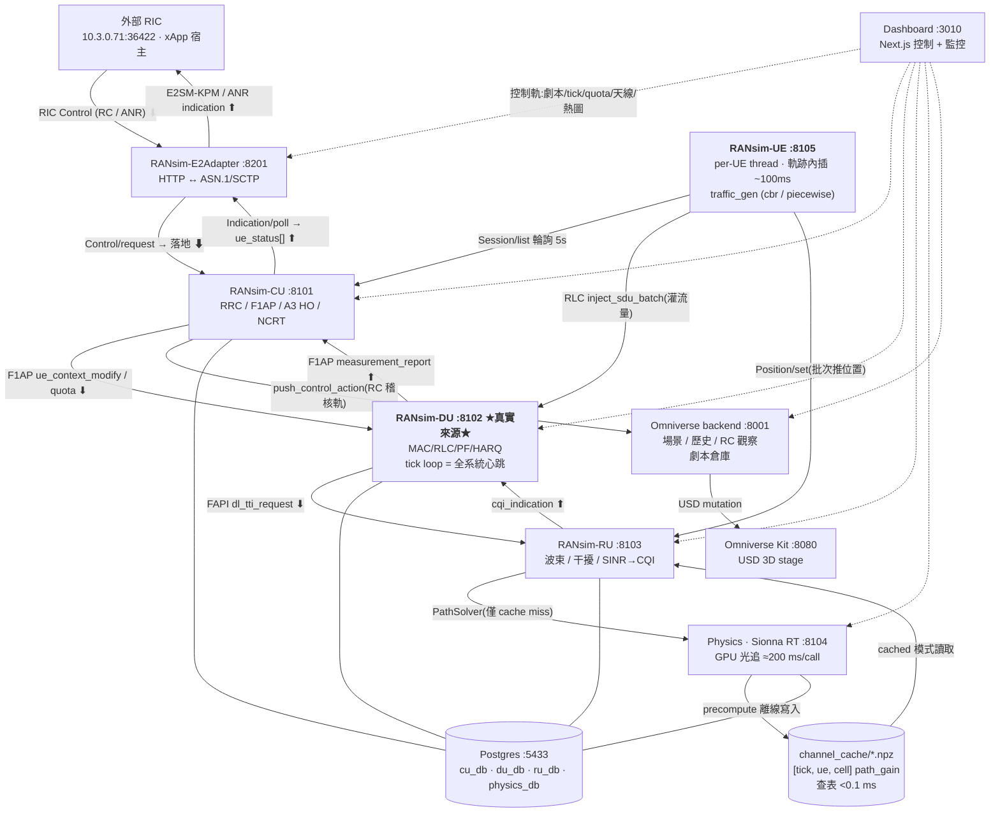
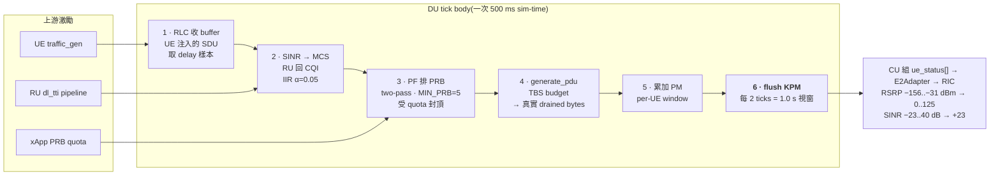
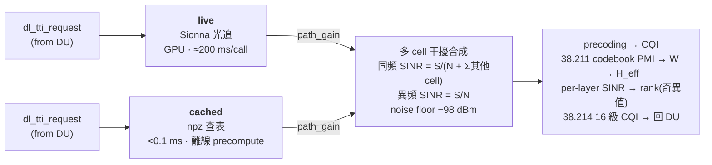

# RAN-SIM 數位孿生：全系統地圖

> 把 OAI/O-RAN 的 CU / DU / RU / UE 拆成七個獨立 Django HTTP 微服務,接上 Sionna RT 光追物理層與 Omniverse 3D,再用一個 HTTP↔ASN.1/SCTP 翻譯器對接外部真實 RIC。
> 目的只有一個:**讓 xApp 先在孿生體裡驗證 handover 與 PRB 控制決策,再上實體 RAN。**

| 項目 | 值 |
|---|---|
| 心跳 | DU tick · `sim_dt` 500 ms |
| 內部解析度 | slot engine 0.5 ms |
| KPM 視窗 | `PM_WINDOW` 1.0 s = 2 ticks |
| E2 傳輸 | SCTP PPID 70 |
| 持久層 | Postgres :5433 × 4 DB |
| 實測倍速上限 | cached ≈ 7–8× |

---

## 圖一 · 誰跟誰講話

整條協定棧沿中軸由上而下:RIC → E2Adapter → CU → DU → RU → Physics。**配置向內流、指標向外流**是這張圖的骨架。UE 從左側同時餵兩件事給模擬:位置給 RU(算通道),流量 SDU 給 DU(餵 RLC buffer)。Dashboard 從右側以一條 HTTP 控制軌接到每一層。

**圖例**:`⬆` 量測上行(KPM / 事件) · `⬇` 控制下行(RC / 配置落地) · 實線 = 模擬資料面 · 虛線 = 人為控制/監控。

E2 閉環的兩個方向是全系統唯一真正「繞一圈回來」的路徑。

---

## 圖二 · 一個 tick 裡發生什麼

整個模擬只有一個時鐘:`DU tick_runner`。每 tick 固定推進 **500 ms sim-time**,wall 時間可以縮短來加速(`sim_speed_x = sim_dt_ms / wall_tick_ms`,wall=50 ms 即 10×)。tick 內部再由 slot engine 以 **0.5 ms slot** 逐 slot 建模 TDD、K0 pipeline、BLER/HARQ 與 FIFO drain —— 延遲是這樣長出來的,不是套公式算出來的。

**tick 內部**:slot engine 逐 0.5 ms slot 跑 TDD 上下行 · K0 pipeline(到達→可排)· BLER/HARQ retx · FIFO drain → departure timestamp = SDU delay。

**DU 是唯一時鐘**;CU 與 E2Adapter 用 pull 自己跟上,UE 用 DU 實際達成倍速回校注入量。步驟 1–6 在 DU 行程內同步跑完,只有第 2 步需要跨容器打 RU —— 那個 HTTP RTT 就是全系統倍速卡在 7–8× 的原因(不是 Sionna,也不是 CPU)。

---

## 圖三 · 物理層的兩種模式

同一條 RU 管線,通道來源可以換。這是整個平台最重要的一個開關:它決定你今天能跑幾倍速。

| 模式 | 每 tick 成本 | 倍速上限 | 說明 |
|---|---|---|---|
| live | ≈200 ms(GPU) | 約 2× | 每 tick 即時算,wall 撐不住 |
| cached | <0.1 ms | 7–8× | 跳過 GPU,瓶頸換成 HTTP RTT |

**兩模式只差第一格**;干擾、波束、CQI 產生完全共用同一份程式碼。cached 不是「簡化模型」—— 它是同一顆 Sionna 引擎離線逐 tick 算好的 `[tick, ue, cell]` path_gain 回放,因此物理保真度相同,只是失去對臨場改動幾何的反應能力。

---

## 每個模擬在算什麼

每一列是一個 Django app。這張表是讀 code 的入口:知道要改的東西在哪個服務的哪個 app,剩下的就好找了。

### RANsim-CU `:8101` — gNB-CU,訊令與決策中樞

| 模組 | 算什麼 | 對應 OAI |
|---|---|---|
| `cu_cp` | RRC 狀態機、A3 換手評估、F1AP/NGAP/E2 訊令、UE context、KPM 匯集、NCRT 鄰區關係表(ANR) | `rrc_gNB.c`、`f1ap_cu_*`、`ngap_gNB.c` |
| `cu_up` | PDCP/SDAP/GTP-U 使用者面、E1AP bearer、DRB 管理 | `PDCP_v10.1.0/`、`SDAP/` |

### RANsim-DU `:8102` — 模擬的真實來源,所有 KPM 從這裡長出來

| 模組 | 算什麼 | 對應 OAI |
|---|---|---|
| `tick` | slot 時鐘(SFN/slot)、sim/wall 解耦、PM 視窗、`measurement_report` 觸發、RLC delay 模型(`calib` ÷30 / `subtick` 誠實佇列)、discardTimer 300 ms | `gNB_scheduler_*` 主迴圈 |
| `mac` | PF 排程(`PF = inst_rate / avg_rate`,IIR α=0.05;two-pass 分配;retx-aware demand ×1/(1−BLER))、HARQ、BLER 外迴路 link adaptation(OAI get_mcs_from_bler 等價)、PRB quota 封頂 | NR_MAC_gNB scheduler |
| `rlc` | per (ue, bearer) 的 TM/UM/AM entity、SDU→PDU 分段、retx 佇列、status PDU NACK bitmap、BO 回報、SDU delay 取樣 | `nr_rlc_entity.c`、`nr_rlc_am*.c` |
| `f1ap_du` | F1Setup、UE context CRUD(建 RLC/MAC/HARQ)、DL/UL RRC 轉送、measurement_report 匯集 | `f1ap_du_task.c` |
| `fapi_north` | DL/UL TTI request 組裝、CQI indication 回饋、CRC→HARQ 回饋 | nFAPI DL/UL TTI |

### RANsim-RU `:8103` — O-RU,幾何與電波在這裡變成 CQI

| 模組 | 算什麼 | 對應 OAI |
|---|---|---|
| `antenna` | 天線陣列、cell 定義、UE 位置 DB、RuController 配置 API | `antenna.c` + cell 身分 |
| `beamforming` | 38.211 Type I codebook、PMI 查找、precoder W、SINR/rank/CQI 估計 | `nr_modulation.c`、`nr_feptx_prec` |
| `fapi_south` | DL/UL TTI pipeline(圖三那條):live/cached 雙模、真實多 cell 干擾、`inter_freq` 開關、`tx_power` 旋鈕 | `ru_thread()` |
| `phy_low` | RU state(SFN/slot/numerology/FFT/CP)、OFDM 描述 | `nr_ru_timing.c`、`ofdm.c` |
| `physics_client` | 組 PathSolverRequest 打 Physics、L2 cache(同位置同配置不重打,TTL 0.5 s) | RU → 物理引擎 |

### RANsim-UE `:8105` — UE 群 + 劇本執行器,整個模擬的激勵源

| 模組 | 算什麼 |
|---|---|
| `scenario` | 載劇本 JSON → 套場景幾何(推 Omniverse/Physics)→ 切 channel mode → bulk attach → 啟動 DU tick。**自己不 tick**,時間軸由 DU 驅動 |
| `ue_lifecycle` | 每 UE 一條執行緒:poll CU 差異、軌跡內插(~100 ms)、推位置給 RU、量測輪詢、掉話重選網、劇本離場可見性 |
| `traffic_gen` | 灌流量的地方。`idle` / `cbr`(rate_mbps)/ `piecewise`(依 sim-second 查 schedule 切 rate)。刻意**把整個 tick 該注的 byte 包成一個大 SDU** 丟給 RLC(省 HTTP,RLC 內部自然分段);`TRAFFIC_BURST_BYTES` 可改成湊滿 burst 才放,模擬 TCP flight 的雙峰延遲 |

### Physics_sim `:8104` — Sionna RT 光追,取代 RF hardware 與 channel model

| 模組 | 算什麼 |
|---|---|
| PathSolver | RU 即時查:載 Mitsuba 場景 → 每 gNB 建 Transmitter + UE 建 Receiver → 光追(max_depth 反彈)→ channel matrix + `path_gain_linear`。engine lock 防並發改 receiver |
| Coverage | Dashboard 熱圖:水平網格高 1.5 m、RadioMapSolver、per grid 算各 gNB RSRP、選配 SINR。計算時**暫停 DU tick**(搶 GPU) |
| precompute | 離線逐 tick 內插 UE 位置 → in-process `compute_paths()`(免 HTTP,快 100×)→ 堆成 `[tick, ue, cell]` 寫 npz。近期加了每 N tick 歸還 DrJit 快取、分段換行程避免撞 mem_limit、斷點續跑,以及從 24h 結果切時窗 cache |
| scenario_store | 劇本/場景倉庫(physics_db)。消費端設 `SCENARIO_STORE_URL` 就能讓 sim 脫離 Omniverse |

### RANsim-E2Adapter `:8201` — gNB E2 termination,唯一對外的真實協定面

| 子模組 | 算什麼 | 對應規範 |
|---|---|---|
| `codec` | E2AP PDU、E2SM-KPM Format3(UE-level)、E2SM-RC Header/Message、Subscription 的 APER 編解碼(pycrate) | E2AP v2.0.3 / KPM v2.0.03 / RC v01.03 |
| `e2sm_anr_codec` | 自定 E2SM(vendor OID `1.3.6.1.4.1.53148.1.1.2.6`,RAN function 6):`SONTRIG_ANR_ADD / REMOVE / FLAG`。Header/Message 走 JSON 而非 ASN.1,因為 WG3 現行規格沒有「觸發 gNB SON」的訊息 | ANR 情境 v10(自定) |
| `sctp_link` | SCTP 常駐 daemon、E2 Setup 握手、per-sub indication 執行緒、Reset debounce | PPID=70 |
| `event_log` | KPM ring(per UE×metric,60 筆 / 30 s stale)、事件 ring | — |
| `sim_bridge` | HTTP client 打 sim CU:拉 E2 node id / indication、落地 control | — |

### Omniverse platform `:8001` / `:8080` — 場景、歷史、RC 稽核與 3D

| 模組 | 算什麼 |
|---|---|
| `ran/actors` | scene / ue / gnb / building / ingest / history / playback / sim_session / control_action / handover / scenario / asset 的 CRUD 與回放,以及 RC 觀察查詢(`RcObservationReader`) |
| `ran/models` | BuildingObject、GnbConfig、UeConfig、SignalHistory、PositionHistory、SimulationSession、ControlAction |
| Kit | USD stage 3D 渲染,由 backend 以 mutation 驅動 |

---

## 平台對外承諾的四條 xApp 迴路

這是整個 DT 存在的理由:xApp 用 KPM 看見、用 RC 動手,動完的效果又回到下一輪 KPM。前三條走標準 E2SM-RC,第四條(ANR)走自定 E2SM。

| Case | KPM 輸入 | 控制動作 | 落地點 |
|---|---|---|---|
| **IM** 干擾管理 | PrbTotDl + UEThpDl + RlcSduDelayDl | E2SM-RC Style 2 / Action 6 — PRB quota | DU `set_prb_quota` |
| **CCO** 覆蓋容量 | PrbTotDl 跨 gNB 差距 | E2SM-RC Style 3 / Action 1 — Handover | CU HO → DU `ue_context_modification` |
| **ES** 節能 | PrbTotDl + PdcpSduVolumeDL(5 min 窗) | HO + PRB quota / Cell On-Off(Style 2 / Action 7) | CU + DU 兩段組合 |
| **ANR** 鄰區自組 | 鄰區量測 / PCI / 關係表狀態 | E2SM-ANR ADD / REMOVE / FLAG(自定 SM,JSON payload) | CU `NrCellRelation`(NCRT),`version` 每次變更 +1 作為 confirm 載體;旗標 `ho_blocklist` / `no_remove` / `xn_blocklist` 被 A3 換手讀取 |

---

## 已知落差:用這張地圖時要記得的四件事

- **`DRB.RlcSduDelayDl` 是秒級,結構性的。** UE 為省 HTTP 把整個 tick 打包成 MB 級「邏輯 SDU」,`calib` 模型又 ÷30 壓平壅塞。語意對、絕對值不真實 —— 要看壅塞請切 `subtick`。
- **倍速上限 ≈ 7–8×。** 拔掉 Sionna 之後仍卡在 DU per-tick wall ≈63 ms,瓶頸是跨容器同步 HTTP RTT,不是 GPU 也不是 CPU。baseline 建議 ≤2×,3× 以上會掉封包、KPM 失真。
- **RSRP 有兩條管線。** Coverage 熱圖與 RU dl_tti(KPM)各算各的,`tx_power` 來源不同,可能靜默不一致。比對數字前先確認你在看哪一條。
- **SCTP 跨 host reboot 脆弱。** 重開機後要重跑 `host_setup_sctp.sh`,否則 E2 起不來。

---

## 起手式:跑一場模擬

| 步驟 | 做什麼 |
|---|---|
| 1 | 上傳劇本到倉庫(Dashboard 或 `ScenarioController/upload`)。劇本裡有 `scene_id`、gNB/cell 幾何與 `power_dbm`、UE 軌跡 `positions`、traffic profile、`cell_quotas`、`inter_freq`、`discard_timer_ms`、`rlc_delay_model` |
| 2 | cached 模式先預算通道:`POST :8104/api/v0.1/Physics/Precompute/run` |
| 3 | 起 sim:`POST :8105/api/v0.1/UE/Sim/SimController/start`,body `{"source":"scenario","scenario_id":"cco_20min","speed_x":2,"sim_dt_ms":250}` —— 自動 scene-apply → UE attach → DU tick → lifecycle |
| 4 | 監控:Dashboard `/logs`(KPM / RC / PRB quota)、`/scenarios`(觸發評估) |
| 5 | 停:`SimController/stop`(清 UE、reset PM / KPM / quota) |

---

## 延伸閱讀

- [`dt_ran_architecture.md`](dt_ran_architecture.md) — 三層式架構總覽(平台 / 模組 / 計算)
- [`workflow.md`](workflow.md) — 運作流程
- [`../scenarios/`](../scenarios/) — 劇本 JSON schema 與 generator
- [`../archive/intents-interface.md`](../archive/intents-interface.md) — xApp 三 case 合約(IM/CCO/ES)
- [`../anr/`](../anr/) — ANR v10 規格、十二題驗證紀錄
- [`../api/rc_observation_api.md`](../api/rc_observation_api.md) — RC 指令拉取 API
