# 前端使用筆記

兩個前端,都是 Next.js dev 模式:

| | 位址 | 用途 |
|---|---|---|
| **場景編輯器** | `:3011` | 建場景、擺元件、產 UE、設定並啟動 run |
| **執行監控** | `:3012` | 看執行中/已結束的 run,只讀 |

本文的截圖是 2026-09-20 用 headless Chromium 實際操作後擷取的,不是示意圖。

---

## 場景編輯器

### 場景清單

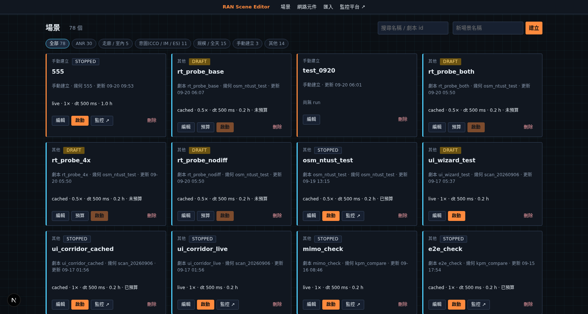

上方的分類籤由 `legacy_scenario_id`(下稱**劇本 id**)的前綴推導:`anr_` → ANR、走廊/室內、意圖(CCO/IM/ES)、規模/全天。**沒有劇本 id 的場景一律歸到「手動建立」。**

每張卡片顯示模式、倍速、`sim_dt`、劇本長度與預算狀態,並依狀態給不同按鈕:`cached` 未預算時會有「預算」,已有 run 時會有「監控 ↗」。

編輯器的四個步驟是固定流程,上方頁籤可直接跳:

```
1 場景與環境  →  2 網路元件  →  3 UE  →  4 模擬與啟動
地圖/匯入/建築盒/材質   gNB/cell/天線/模板   路徑/流量/隨機產生   模式/倍速/Precompute
```

### 步驟 1:場景與環境

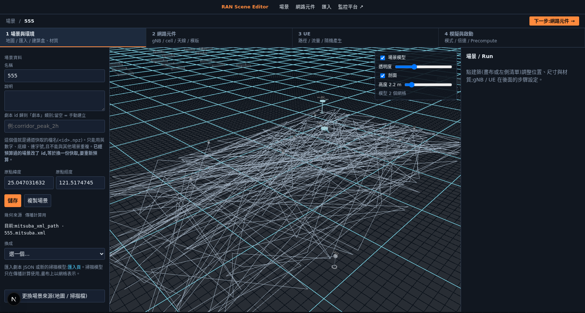

右側「場景資料」可改名稱、說明、原點經緯度,以及 **劇本 id**。

> **劇本 id 是快取檔名。** 這個值會直接變成 `<id>.npz` 與 `<id>.paths`,也會傳給 precompute 的腳本。所以:
> - 只能用英數字、底線、連字號(後端會擋)
> - 不能與其他場景重複(會共用同一份快取、互相覆蓋,後端會擋)
> - **已經預算過的場景改 id,等於指向另一份快取,要重新預算**(前端會跳確認)

「幾何來源」可在掃描模型與「建築盒 / OSM」之間切換。用掃描模型時建築盒會是 0 個 —— 這一點會影響後面幾個地方,見下文。

### 步驟 2:網路元件

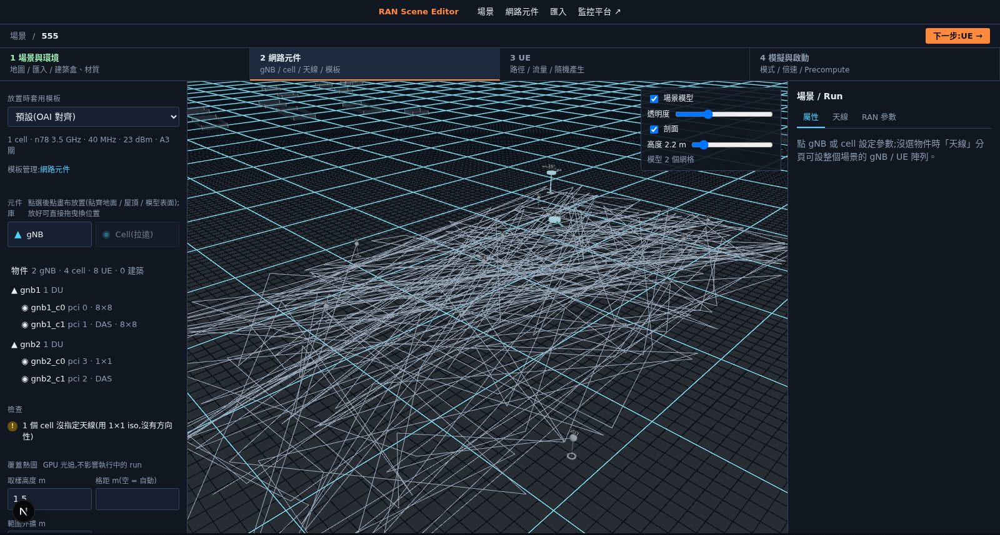

**元件庫**:點一下進入放置模式,再點畫布地面放下。落點會貼齊滑鼠下的表面(地面、屋頂、掃描模型)。放好之後可以直接拖曳換位置。

> **「Cell(拉遠)」要先選 gNB。** 它是 DAS 的拉遠單元,必須掛在某個 gNB 的 DU 底下。沒選 gNB 時按鈕是停用的,放置橫幅也會直接說原因。

**檢查**區會即時列出問題,例如上圖的「1 個 cell 沒指定天線(用 1×1 iso,沒有方向性)」。

**A3 換手預設是關的**,要自動換手得選一個 gNB,在右側屬性面板按「儲存 A3」。預設參數 offset 1 dB、遲滯 0.5 dB、TTT 80 ms 相當積極(接近乒乓),要接近真實行為建議 offset 調到 3 dB 左右。

### 覆蓋熱圖

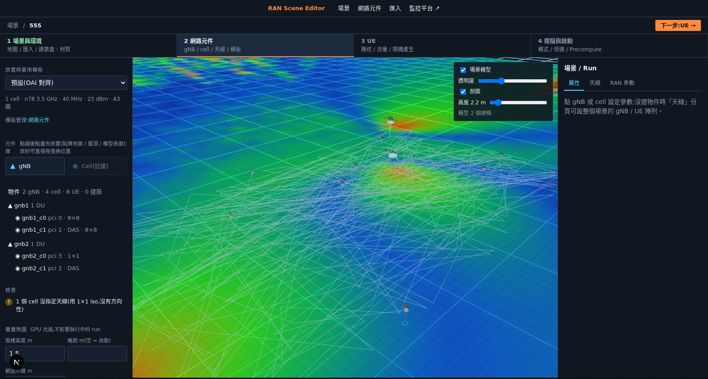

左下「覆蓋熱圖」按「計算覆蓋」,GPU 光追約數秒(650×476 m 的場景約 4.4 秒)。可切三種模式:

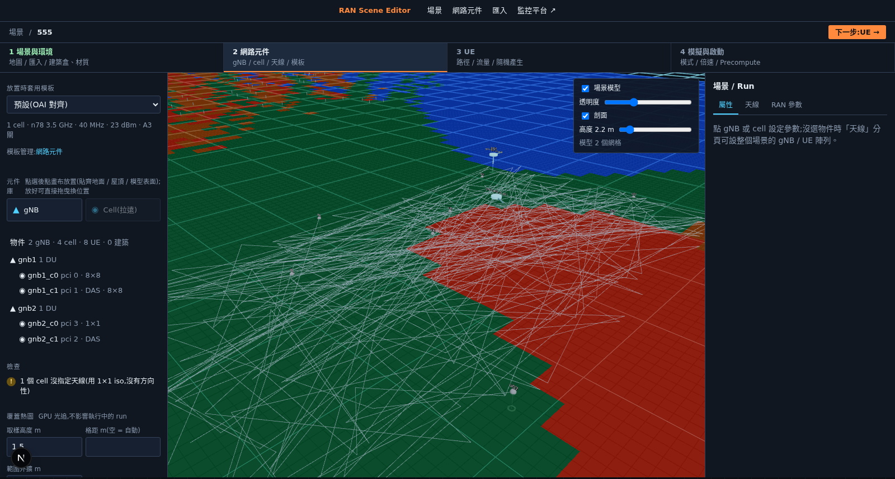

**「最佳 cell」最實用** —— 不同顏色代表每一格該由哪個 cell 服務,一眼看出覆蓋邊界與重疊程度。重疊過多會導致干擾受限:同頻兩個 cell 的 RSRP 若長時間差在 6 dB 以內,高負載時 SINR 會被壓到失聯門檻以下。

> **熱圖假設所有 cell 同時滿載互相干擾(最壞情況)**,所以它的 SINR 會明顯低於實際跑起來量到的值(同一場景:熱圖中位 4.7 dB vs 實測 24 dB)。**它用來看覆蓋形狀與重疊,不是 SINR 的預測。**

「範圍外擴 m」在自動範圍之上再往外擴。自動範圍已經包含掃描模型的實際邊界,一般不需要調。

### 步驟 3:UE

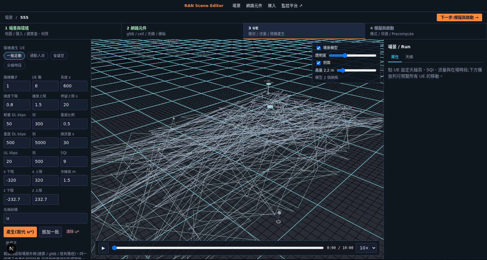

上方四個情境預設(一般走動 / 通勤人流 / 會議室 / 尖峰時段)會套一組參數,再微調下面的欄位。

- **隨機種子**固定 → 同一組參數永遠產生同一批 UE,可重現
- **x/z 上下限**自動帶入整個場地(上圖是 −320~320 / −232.7~232.7)
- 產生的 UE 會**避開建築**:向後端要一張高度圖(垂直往下打射線取表面高度),起點、每個轉折點、以及沿線每 2 公尺取樣都必須落在地面上
- 流量是每 `換流量 s` 秒換一次的隨機上下行,`重度比例` 控制大流量的機率

下方時間軸可預覽所有 UE 的移動。

> **UE 的「在場時段」(`active_windows`)會真的讓它離線。** 時段外 UE 會釋放 RRC、從 DU 排程移除、停止流量,回到時段內再重新 attach。所以畫面上 UE 消失時,它在網路上也真的不在了。若不要這個行為,env `UE_ACTIVE_WINDOW_ENFORCE=0`。

### 步驟 4:模擬與啟動

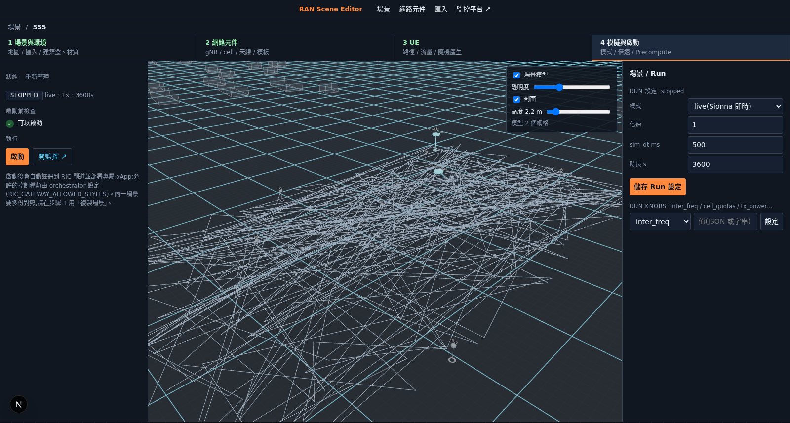

**新場景一定要先按「建立 Run 設定」** —— 場景(靜態設計)與 run(執行設定:模式、倍速、時長、knobs)是分開的兩筆資料,新場景沒有任何 run 設定,啟動前檢查會擋在第一項。

啟動前檢查會依序擋:

| 訊息 | 意思 |
|---|---|
| 還沒有 run 設定 | 按「建立 Run 設定」 |
| cached 模式沒有 cache | 先 Precompute |
| Precompute 還在跑 | 等它跑完 |
| 已有另一個 live run 在跑 | live 同時只允許 1 個 |

警告(不擋啟動):同時 4 個以上 run 會吃記憶體;倍速 > 5× 且 UE > 10 個時 RU 可能跟不上。

**Run knobs** 是傳給執行期的參數,其中 `ric_purpose=validation` 會讓 RIC 對這場做主動探測;常規觀測不要帶。

---

## 執行監控

### Run 清單

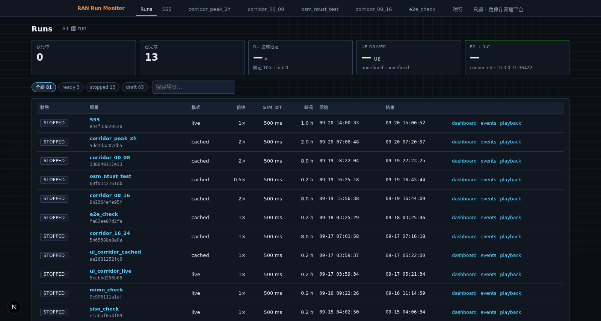

可依狀態篩選。上方頁籤是執行中與最近結束的 run,**已結束的分頁可以按 `×` 關掉**(只記在這台瀏覽器;同一個 run 再開跑會自動回來,正在檢視的那頁不會被關掉)。

### 儀表板

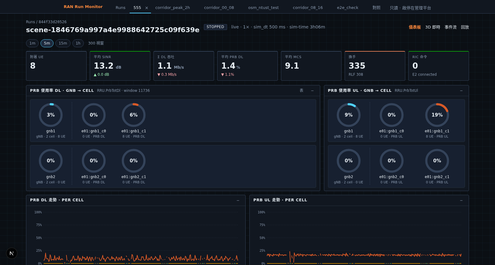

頂端是當下摘要(附著 UE、平均 SINR、Σ 吞吐、平均 PRB、平均 MCS、換手/RLF、RIC 命令數),右上可切 1m / 5m / 15m / 1h 視窗。

PRB 使用率以 gNB 分組,列首是 gNB 平均,後面每個 cell 一個圓環,全部等寬排列。

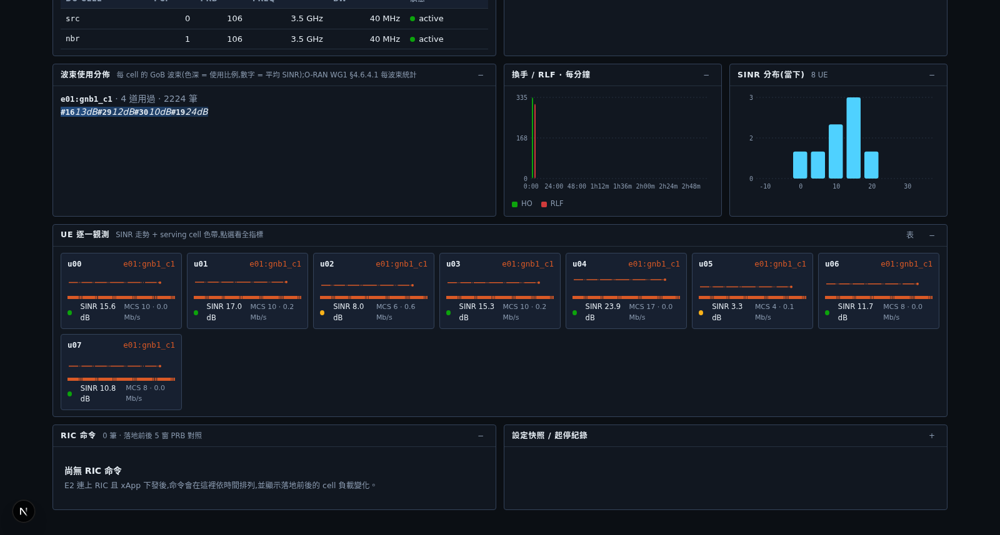

下半部有波束使用分佈(每 cell 的 GoB 波束與平均 SINR)、換手/RLF 每分鐘、SINR 分佈、UE 逐一觀測、RIC 命令落地前後對照。

> KPM 的 `warnings` 欄位會標示資料不完整的視窗,例如「DU 丟棄量測報告 N 筆」—— 有負載時 2× 倍速就可能發生,那段期間 per-UE 統計會偏,cell 級的 PRB/吞吐仍準。

### 3D 即時

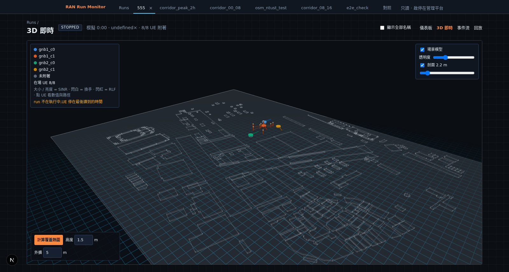

UE 以 InstancedMesh 繪製,顏色 = 服務 cell、大小/亮度 = SINR、閃白 = 換手、閃紅 = RLF。右上可調場景模型透明度與剖面高度。

左下的**覆蓋熱圖**與編輯器同一支計算,疊在 3D 上:

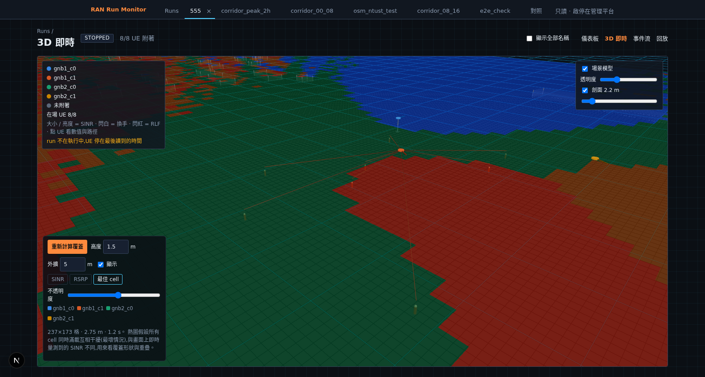

---

## 已知限制

1. 熱圖是一次性計算,不隨 run 更新(它是理想值,與即時量測本來就不同)。
2. 3D 鏡頭在幾何邊界取回後會重新取景一次,開啟大場景時會看到畫面跳動一下。

### 2026-09-21 已修

- **3D 相機沒框住整個場景** —— 鏡頭範圍只取 gNB / UE / 建築盒,掃描模型的尺寸不在內。已改成併入真實邊界。
- **儀表板標題顯示 scene_uuid** —— 只取 `legacy_scenario_id`,手動建立的場景沒有就掉到 uuid。已補場景名稱。
- **run 結束後顯示其他場景的 cell** —— per-run 容器移除後 `runtimeBase` 會**默默退回讀共用的舊 DU**,把別的場景的 cell 當成這個 run 的列出來(實際看到走廊的 `src` / `nbr`)。已改成 run 不在執行中就不讀即時狀態,面板直接顯示「per-run 容器已收掉 · 無即時資料」。
- **3D 標題出現 `undefined×`** —— run 停掉後 driver 沒回 `sim_speed_x`。

---

## 常見狀況

**監控頁全部是空的**
先看「劇本進度」:若停在 `0:00 / preparing`,是還沒開始跑。手動建立的場景過去會在開場卡 60 秒(CU 找不到同名的 ANR fixture 檔而重試),已修正為直接略過。

**UE 從 3D 畫面消失,但資料還在**
檢查該 UE 的「在場時段」。時段外 UE 會真的離線(見步驟 3 的說明);若劇本長度大於軌跡長度,也可能是軌跡走完了 —— 這時 UE 會停在終點,不會消失。

**UE 全部擠在同一個 cell、不換手**
依序查:A3 是否開啟(預設關)→ 鄰區關係是否存在。跨 gNB 的鄰區關係**不會自動產生**,正常情況由 xApp 經 E2 下 `anr-add` 建立;沒有 RIC 的單機情境可開 `ANR_AUTO_ADD=1` 讓 CU 自己從量測報告學。CU 的 `Mobility/A3Controller/read` 會回 `nrt_missing`,列出因缺關係而擋掉的換手次數。

**地圖搜尋出現 `Unexpected token '<'`**
前端拿到 HTML 錯誤頁而不是 JSON,表示請求打錯位址。檢查編輯器容器的 `NEXT_PUBLIC_INGEST_BASE_URL`;若改過 compose,記得清 `.next` 建置快取,否則舊值仍被編進 bundle。
