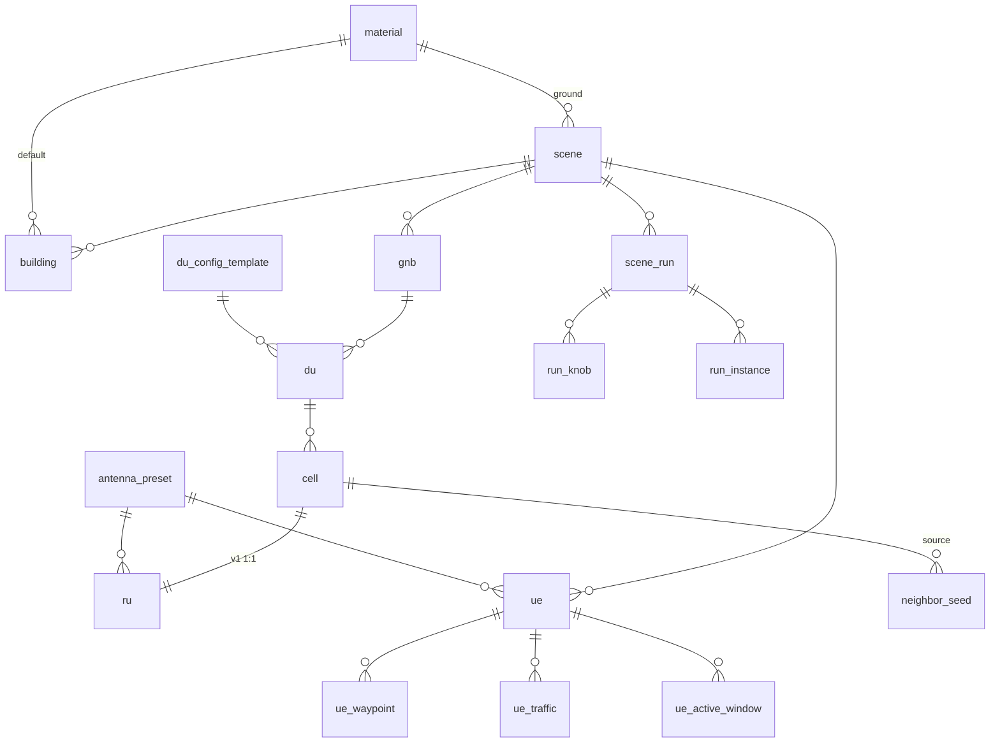

# 平台重構計畫(v0 草案,待討論)

> 建立 2026-09-12。依 2026-09-12 討論的構想整理:三平台 / DB 管理網元 / 多場景並行。
> 這份是**討論稿**,§7 列了七個要你拍板的決策,拍完才進 §6 的執行階段。
> 背景文件:[`ne_and_parameters.md`](../architecture/ne_and_parameters.md)、
> [`antenna_array_reference.md`](../architecture/antenna_array_reference.md)、
> [`mimo_antenna_selection_plan.md`](../architecture/mimo_antenna_selection_plan.md)

---

## §0 先講結論:同意的、要挑戰的、你漏掉的

### 同意
* 三平台拆分,每個系統一個 Django —— 對,而且現在的 `Physics_sim/` 把 Dashboard、precompute、scenes、data 全塞一起,拆了才乾淨。
* 最上層是 `scene`,一個 scene 可啟動多次 —— 對,但要拆成 **`scene`(設計)** 與 **`scene_run`(執行實例)** 兩張表,否則「同一場景跑兩次不同倍速」沒地方記。
* DU/RU 設定從 DB 拉 —— 對。
* 天線做成 preset 選單 —— 對,而且 `antenna_array_reference.md` §7 的 schema 可以直接用。
* 劇本匯入 → 貼進 DB —— 對,而且**劇本 JSON 應該降級成「匯入格式」,不再是執行期格式**。

### 要挑戰的(§4 詳述)
1. **CU「公用」不成立。** CU 持有 per-scene 狀態(`CellConfig`、`UeContext`、`DuRegistry`、`NrCellRelation`、A3 設定是全域 singleton)。兩個場景共用一個 CU,等於兩個 gNB 共用一份 RRC —— 不是資源共享,是狀態互相污染。
2. **E2Adapter 是單一 E2 node。** 啟動時向 CU 拿一次 node_id、開一條 SCTP。多場景 → RIC 該看到幾個 gNB?這是語意問題,不是工程問題。
3. **Physics 是 singleton,且天線陣列是 scene-global。** live 模式下**物理上不可能**同時跑兩個不同建築的場景(一個 engine 只載一個 Mitsuba scene)。

### 你漏掉的
* **UE 服務**(現 `RANsim-UE`)。它是劇本執行器 + 位置推送 + 流量注入,是每個 run 的激勵源,**必須 per-run**。你的清單只寫了 CU/DU/RU/物理。
* **地圖/掃描匯入管線目前住在 Omniverse backend**(`map_actor`、`glb_to_mitsuba`、`scan_segmentation`、`scan_material_classifier`,共 ~1,200 行)。你說 Omniverse 是可拆的外掛,那這整套要先搬到管理平台,否則拆掉 Omniverse 就沒有建築匯入了。

---

## §1 資料夾結構(2026-09-12 依 backend_rule / frontend_rule 改寫)

**命名鐵則**(來自討論):資料夾名稱要讓人一眼知道它在完成什麼事,**不准出現 `shared/`、`data/`、`common/`、`utils/`、`core/` 這類未分類名稱**。
後端 repo 依 `backend_rule.md §1-1`:`{platform}-{system}`,中線連接。前端是系統等級的一個資料夾,同樣套 `{platform}-{system}`。

```
XAPP_DT/
│
├─ ran-scene-management/                          ── 管理平台 ──
│  ├─ ran-scene-management-network-element-registry/     Django:scene / gnb / du / cell / ru / ue / building
│  │                                                       全部網元表 + lookup 表(material、antenna_preset、du_config_template)
│  │                                                       + 劇本匯入器 + scene_run 建立/查詢
│  ├─ ran-scene-management-building-geometry-ingest/     Django:GLB 掃描(面片分割 → 材質分類 → Mitsuba XML)、
│  │                                                       OSM(geocode / bbox generate)、手畫方塊
│  │                                                       ← 從 Omnivers_platform/Omniver-RAN/main/apps/ran/ 的
│  │                                                         map_actor、glb_to_mitsuba、scan_segmentation、
│  │                                                         scan_material_classifier 搬出
│  └─ ran-scene-management-scene-editor-frontend/        Next.js(App Router):3D 畫布、場景列表、資源庫、匯入
│                                                          ← 從 Physics_sim/Dashboard 搬出並重刻
│
├─ ran-emulation-runtime/                         ── 模擬平台 ──
│  ├─ ran-emulation-runtime-run-orchestrator/            Django(新):scene_run 生命週期、容器 spawn、port 配置、
│  │                                                       健康輪詢、呼叫 RIC 的 xApp pod API(見 §1.1)
│  ├─ RANsim-CU/                                         (沿用現名;per-run)
│  ├─ RANsim-DU/                                         (沿用現名;per-run)
│  ├─ RANsim-RU/                                         (沿用現名;per-run)
│  ├─ RANsim-UE/                                         (沿用現名;per-run;軌跡推送 + 流量注入)
│  ├─ Physics_sim/                                       (沿用現名;共用;只留 main/ + precompute/,
│  │                                                       Dashboard、scenes、data 各自搬走)
│  ├─ RANsim-E2Adapter/                                  (沿用現名;共用;多 E2 node)
│  └─ ran-emulation-runtime-interface-protocol/          ← Physics_sim/ran-sim-protocol(Python 套件,非 Django;
│                                                          見 §1.2)
│
├─ ran-3d-rendering/                              ── 渲染平台(外掛,之後)──
│  └─ ran-3d-rendering-omniverse-kit-sync/               ← Omnivers_platform(只留 Kit + USD 同步)
│
├─ sionna-channel-cache/                          precompute 產出的 .npz(現 Physics_sim/data/channel_cache)
├─ scanned-building-assets/                       GLB + materials.npz + 產出的 Mitsuba XML(現 Physics_sim/scenes)
├─ docker-compose-deployment/                     compose、postgres-init、host_setup_sctp(現 deploy/)
├─ docs/
└─ new_plan/
```

### 1.1 `run-orchestrator` 是做什麼的

**現在「起一場模擬」這件事是由 `RANsim-UE/.../sim_orchestrator.py` 做的**:讀劇本或 Omniverse 三表 → 套場景 → attach UE → 廣播倍速給 DU/CU → 建 SimulationSession → 起 tick。它只會起**一場**,而且假設 CU/DU/RU 已經在固定 port 跑著。

多 run 之後,「起一場」多了它做不了的事:

| 動作 | 現在誰做 | 多 run 後 |
|---|---|---|
| 讀場景設定 | UE 服務讀劇本 JSON | 從 `network-element-registry` 讀 `scene_run` |
| **起 CU/DU/RU/UE 容器** | 沒人(compose 開機就起好) | **orchestrator 用 docker SDK 起 `cu-17`、`du-17`…,注入 `SCENE_RUN_UUID`** |
| 配 port / 服務名 | 固定 8101–8105 | 動態,寫進 `run_instance` |
| 排 precompute | 手動打 Physics API | job queue,GPU 序列化 |
| 通知 RIC 建 xApp pod | 沒有 | 呼叫你提供的 pod API |
| 健康、停止、清理 | UE 的 `stop_sim()` 只停自己 | 停四個容器 + 關 SCTP + drop schema |

所以 orchestrator = **把 `sim_orchestrator.py` 從「單場、單機、固定 port」升級成「多場、容器級、動態配置」的那一層**,並從 UE 服務裡搬出來 —— UE 服務只該管 UE,不該管別人的生死。

### 1.2 `interface-protocol` 是做什麼的

就是現在的 `Physics_sim/ran-sim-protocol/`,一個 pip 套件 `ran_sim_protocol`。內容是**跨系統介面的訊息定義**:

| 檔 | 定義誰跟誰講話 |
|---|---|
| `f1ap.py` | CU ↔ DU |
| `fapi.py` | DU ↔ RU |
| `e1ap.py` | CU-CP ↔ CU-UP |
| `ngap.py` | CU ↔ Mock 5GC |
| `physics.py` | RU → Physics(PathSolverRequest/Response) |
| `common.py` | 上面共用的 dataclass(`AntennaArrayConfig`、`GnbSpec`、`CellSpec`…)|
| `rsrp_model.py` | RSRP/SINR 換算的單一事實源(Coverage 與 KPM 共用)|
| `serde.py` | dataclass ↔ dict |

DU import 它 10 處、RU 9 處、Physics 1 處。它現在**住在 Physics_sim 裡面**,但 Physics 只是它三個使用者之一 —— 放那裡是歷史因素。搬成平台底下的獨立套件,DU/RU/Physics 各自 `pip install -e ../ran-emulation-runtime-interface-protocol`。

它不是 Django、沒有 API、沒有 DB,所以 `backend_rule` 的 tree 不適用;但命名照 `{platform}-{system}`。

**為什麼網元表全部放在一個系統(`network-element-registry`)而不是拆成 UE / 場景 / 網元三個系統**:
你要用 FK 管理。`backend_rule.md §12-2` 規定跨資料庫/跨 repo 的關聯只能用 `CharField f_<x>_uuid` 手動維護一致性,**真正的 `ForeignKey` 只能在同一個 DB 內**。三個系統就是三個 repo 三個 DB,FK 就沒了。所以手繪圖的三欄(UE / 場景 / 網元管理)對應到**同一個 Django repo 裡的三個 app**:

```
ran-scene-management-network-element-registry/main/apps/
├─ scene_layout/          scene、building(幾何與材質引用)
├─ radio_access_element/  gnb、du、cell、ru、neighbor_seed
├─ user_equipment/        ue、ue_waypoint、ue_traffic、ue_active_window
├─ preset_catalog/        material、antenna_preset、du_config_template
└─ simulation_run/        scene_run、run_knob、run_instance
```

**搬家原則**:第一步只 `git mv`,不改 import 路徑以外的東西,compose 改路徑後**舊流程要能原樣跑通**。重構在能跑的基礎上做,不是先拆再修。

---
## §2 DB Schema

### 2.1 設計原則

| 原則 | 為什麼 |
|---|---|
| **`scene` 與 `scene_run` 分開** | 設計是靜態的、可重複啟動;執行是動態的、有狀態機 |
| **真 RAN 參數進網元表,模擬器旋鈕進 `scene_run`** | 沿用 `ne_and_parameters.md` 的區分:管理平台的網元介面不該出現「倍速」「delay 模型」這種現實沒有的東西 |
| **lookup 表用 FK,不用字串** | 材質、天線 preset、config 模板 —— 改一處全場景生效,且下拉選單直接查表 |
| **階層對齊 O-RAN:gNB → DU → Cell → RU** | 你的草案是 gNB → Cell → (DU, RU)。但 DU 服務多個 cell,DU 設定掛在 cell 上會重複。v1 可以「每 gNB 預設一個 DU」讓 UI 看起來像你的草案,但表要留對 |
| **Cell 有自己的 position(nullable)** | null = 沿用 gNB 位置(共站);有值 = DAS/遠端 RU。沿用現有 RU `Cell` model 的做法 |
| **每表 `id` + `<table>_uuid` + `<table>_created_at/updated_at`** | `backend_rule.md §11-2`;業務關聯一律用 uuid,不用整數 id |
| **FK 寫法固定** | `ForeignKey(to_field='<parent>_uuid', db_column='f_<parent>_uuid', on_delete=CASCADE, related_name=...)`(§12-1)。下面表格的「FK」都指這個形式 |
| **一個 table 一個 model 檔** | `backend_rule.md §5-1`;§2.3 的每一列 = `models/<table>.py` 一個檔 |

### 2.2 ER 圖



### 2.3 各表欄位

**Lookup(平台預載,使用者可新增)**

| 表 | 欄位 |
|---|---|
| `material` | `id`, `key`(concrete/glass/metal/brick/wood), `itu_id`, `freq_range_ghz`, `notes` —— 對應 `mitsuba_builder.MATERIAL_MAP` |
| `antenna_preset` | `id`, `name`, `source`(3gpp/vendor/custom), `pattern`(iso/dipole/hw_dipole/tr38901), `rows`, `cols`, `polarization`(V/H/VH/cross), `v_spacing`, `h_spacing`, `polarization_model`, `max_gain_dbi`, `notes` —— 預載:3GPP 單極化 1×1 tr38901、雙極化 cross 4×4、8×8、UE dipole 1×1 等 |
| `du_config_template` | `id`, `name`, `tdd_pattern`, `numerology`, `n_prb`, `min_prb`, `pf_alpha`, `target_bler`, `rlc_discard_timer_ms`, `rlc_tx_maxsize_bytes`, `harq_max_retx`, `qos_gbr_first`, `gbr_max_share` |

**場景設計**

| 表 | 欄位 |
|---|---|
| `scene` | `id`, `name`, `description`, `origin_lat`, `origin_lon`, `bounds`, `ground_material` FK, `created_at`, `updated_at` |
| `building` | `id`, `scene` FK, `name`, `source`(glb_scan / osm / manual_box), `geometry_ref`(GLB 或 Mitsuba XML 路徑;manual_box 則為 size), `position`, `rotation`, `scale`, `default_material` FK, `materials_npz`(掃描逐面材質,nullable), `created_at` |
| `gnb` | `id`, `scene` FK, `name`, `gnb_id`(int), `plmn_mcc`, `plmn_mnc`, `position`, `a3_enabled`, `a3_offset_db`, `a3_hys_db`, `a3_ttt_ms`, `created_at` |
| `du` | `id`, `gnb` FK, `name`, `gnb_du_id`, `config_template` FK, `config_override`(json, nullable) |
| `cell` | `id`, `du` FK, `name`, `pci`, `nr_cellid`, **`arfcn`**, `band`, `bandwidth_mhz`, `position`(nullable), `azimuth_deg`, **`tilt_deg`**, `power_dbm`, `is_active`, `is_barred`, `created_at` |
| `ru` | `id`, `cell` FK(v1 1:1), `name`, `antenna_preset` FK, `antenna_override`(json, nullable), `noise_figure_db` |
| `neighbor_seed` | `id`, `source_cell` FK, `target_cell` FK, `ho_blocklist`, `no_remove`, `xn_blocklist` —— ANR 劇本的初始 NCRT,選填 |
| `ue` | `id`, `scene` FK, `name`, `antenna_preset` FK, `antenna_height_m`, `qos_5qi`, `color` |
| `ue_waypoint` | `id`, `ue` FK, `ord`, `t_sec`, `x`, `y`, `z` |
| `ue_traffic` | `id`, `ue` FK, `pattern`(idle/cbr/piecewise), `rate_mbps`, `schedule`(json), `bearer_id` |
| `ue_active_window` | `id`, `ue` FK, `t0_sec`, `t1_sec` |

**執行**

| 表 | 欄位 |
|---|---|
| `scene_run` | `id`, `scene` FK, `mode`(live/cached), `speed_x`, `sim_dt_ms`, `duration_sec`, `status`(pending → precomputing → ready → running → stopped / failed), `cache_path`, `e2_node_id`, `created_at`, `started_at`, `stopped_at`, `notes` |
| `run_knob` | `id`, `scene_run` FK, `key`, `value` —— 模擬器旋鈕:`inter_freq`、初始 `cell_quotas`、`NR_TBS_SPEC_MODE` 等旗標、`scene_loss_db` |
| `run_instance` | `id`, `scene_run` FK, `role`(cu/du/ru/ue_driver), `container_id`, `host_port`, `status`, `last_heartbeat` |

### 2.4a 劇本匯入器逼出的 schema 修正(2026-09-12,P1-1)

`scene.legacy_scenario_id / geometry_scene_id / geometry_source`、`gnb.is_active / color`、`cell.center_frequency_ghz`(保留非 raster 頻率,arfcn 由它推導)、`ue.loop / speed_mps`;`gnb.a3_*` 改 nullable(None = 未指定 → CU env)。詳見 progress_log P1-1。

### 2.4 新增的三個欄位(對照 `ne_and_parameters.md` 的三個「該優先補」)

* **`cell.arfcn`** —— 補了它,`inter_freq` 這個假開關就能退休,同頻/異頻變成推導結果。
* **`cell.tilt_deg`** —— CCO 的核心旋鈕,現在只有 azimuth。
* **`du_config_template.n_prb`** 隨 template 而非全域 —— 現在是全域 106,不隨頻寬變。

---

## §3 管理平台前端

參考風格:你給的掃描室內圖(極簡白模、orbit / grid / cube / camera 控制、Layers、Walkthrough)。
技術:**react-three-fiber + drei**(GLTFLoader 你現有的 `MeshImporter.tsx` 已在用),GPU 渲染。**只留 3D**,2D top-down 與 Omniverse 面板全部拿掉。

### 頁面

| # | 頁面 | 功能 |
|---|---|---|
| 1 | **場景編輯器**(畫布) | 左:物件樹(scene → gnb → du → cell → ru;ue;building)。中:3D 畫布。右:選中物件的屬性面板。<br>操作:拉 gNB → 自動建 1 DU + 1 cell 在同位置 → cell 可再加 → **拖曳以 cell 為單位**(拖離 gNB = DAS)→ cell 依 gNB 著色 + 標籤 → 點 ru 選天線 preset。<br>UE:點地面放 waypoint、設時間、流量。<br>建築:三種匯入(GLB 掃描 / OSM 框選或搜尋 / 手畫方塊),點選改材質。<br>儲存 → 寫 DB。 |
| 2 | **場景列表 / 啟動** | 卡片列表(縮圖、網元數、最後修改)。點選 → 載入畫布。<br>每張卡顯示 **active runs**(狀態、倍速、已跑時間)。<br>動作:**Precompute**(選倍速與時窗)、**Start**(live/cached、倍速、sim_dt)、**Stop**、開 KPM 監控。 |
| 3 | **資源庫**(建議新增) | 天線 preset、材質、DU config template 的 CRUD。沒有這頁,preset 只能改 DB。 |
| 4 | **匯入**(建議新增) | 劇本 JSON / GLB / OSM 三種入口,匯入後預覽再寫入。 |
| 5 | **執行監控**(沿用) | 現有 `/logs` 的 KPM / RC 面板,加 run 選擇器。 |

### 畫布的物件模型(對齊 §2)

| 畫布物件 | 可拖曳 | 顏色/標籤 | 屬性面板 |
|---|---|---|---|
| gNB | 是(群組,拖動連帶所有共站 cell) | 群組色 | name、gnb_id、PLMN、A3 |
| **Cell** | **是(獨立)** | 承襲 gNB 色 + `gnb/cell` 標籤 + azimuth 扇形示意 | pci、arfcn、bw、power、azimuth、tilt、active、barred |
| RU | 否(掛在 cell 上) | — | antenna preset 下拉 + override |
| UE | waypoint 逐點拖 | 自訂色 | 天線、高度、QoS、流量、在場時段 |
| Building | 是 | 依材質著色 | 材質、來源、幾何 |

---

## §4 模擬平台:多場景並行的隔離設計

這是整個重構最難的部分,先把三個共用元件的真實限制講清楚。

### 4.1 三個「公用」元件的真相

| 元件 | 你的假設 | 實際狀態 | 建議 |
|---|---|---|---|
| **CU** | 公用 | 持有 per-scene 狀態:`CellConfig`、`UeContext`、`DuRegistry`、`NrCellRelation`、A3 全域 singleton、`/app/tmp/a3_override.json` 落盤 | **改成 per-run**。理由:CU 的所有狀態本來就是「這個 gNB 的」,共用得到的不是資源節省而是狀態污染。且 per-run CU 自然對應 per-run E2 node |
| **E2Adapter** | 公用 | 單 E2 node、單 SCTP、啟動時向 CU 拿一次 `node_id` | **保持共用,但改成多 E2 node 多 SCTP**:每個 run 的 CU 註冊自己的 global E2 node ID,E2Adapter 對 RIC 開一條 SCTP association per run。**需先驗證 RIC(10.3.0.71)接受同 IP 多個 E2 node** |
| **Physics** | 公用 | engine singleton、一次一個 Mitsuba scene、天線 scene-global、GPU lock | **保持共用,但立規則**:並行 run **只允許 cached 模式**;live 模式同時最多 1 個 run。precompute 走 job queue 序列化(你已有分段 + 斷點續跑) |

### 4.2 每個 run 長什麼樣

```
scene_run #17 (cached, 3x)
  ├─ cu-17          容器,env SCENE_RUN_ID=17,啟動時向管理平台拉 gnb/cell/a3 設定
  ├─ du-17          env SCENE_RUN_ID=17,拉 du_config + cells;tick 是這個 run 自己的心跳
  ├─ ru-17          拉 cells + ru/antenna;cached → 讀 cache_path 的 npz
  ├─ ue-17          拉 ue/waypoint/traffic;推位置給 ru-17、注流量給 du-17
  │
  ├─ physics        (共用)cached 模式下 run 期間不打它;precompute 時排隊
  └─ e2adapter      (共用)為 cu-17 開一條 SCTP → RIC 看到一個新的 E2 node
```

**orchestrator** 負責:
1. `POST /scene_runs` → 驗證 scene 完整性(每 cell 有 ru、每 ue 有 waypoint…)
2. cached → 丟 precompute job(序列 GPU 排隊),完成後 `status=ready`
3. `start` → 用 docker SDK 起四個容器,注入 `SCENE_RUN_ID` 與服務名(`du-17` 等),寫 `run_instance`
4. 健康輪詢 → 更新 `run_instance.last_heartbeat`
5. `stop` → 通知 e2adapter 關 SCTP → 停容器 → `status=stopped`

### 4.3 DU/RU 怎麼拿設定:走管理平台的 Actor API(全 POST)

`backend_rule.md §7`:URL 固定 `/api/v0.1/{System}/{Module}/{Component}/{Element}`,**所有 API 一律 POST**,不用 GET/PUT/DELETE。所以 DU/RU 啟動時打的是:

```
POST /api/v0.1/Network_element_registry/Radio_access_element/CellReader/read
     body: { "f_du_uuid": "..." }
POST /api/v0.1/Network_element_registry/Radio_access_element/RuReader/read
     body: { "f_cell_uuid": "..." }
POST /api/v0.1/Network_element_registry/Simulation_run/SceneRunReader/read
     body: { "scene_run_uuid": "..." }
```

Actor 端就是標準的 `read`(依 `backend_rule.md §4-1` 的 create/read/update/delete 四式)。**不需要特製 bundle**;要一次拉整棵樹的話,在 `SceneRunReader` 加一個 custom action `read_full_tree` 即可,仍是 POST、仍走 Actor → Serializer → 通用 `SqlDbBusinessService.get_entity()`。

理由不變:直接讀 DB 等於把管理平台的 schema 變成模擬平台的相依。走 Actor 一層之隔,schema 可獨立演進。

**v1 可以先直讀 DB**(快),但呼叫端先包成上面那幾支的形狀,之後換成 HTTP 不動呼叫端。

**run 期間設定凍結**:容器啟動時拉完存記憶體,run 期間不再打管理平台(見 §8.3)。
### 4.4 塞車:三個瓶頸

| 瓶頸 | 現況 | 並行後 |
|---|---|---|
| **GPU** | live 每 tick 打 Sionna ~200ms | cached-only 並行 → run 期間**零 GPU**;GPU 只給 precompute 排隊 |
| **跨容器 HTTP RTT** | 單 run 上限 ~7–8×(DU↔RU ~45ms/tick) | 每 run 自己一組容器,互不等待;總量受 CPU 核數限制,**N 個 run 各跑 3× 比 1 個跑 8× 實際** |
| **Postgres** | 4 個 DB | per-run 容器各自 schema(`cu_17`、`du_17`…)或共用 DB 加 `scene_run_id` 欄位。**建議前者**:stop 時 drop schema 即清乾淨,不留殘骸 |

### 4.5 Port 與命名

不要用固定 port(8101/8102…)。orchestrator 起容器時:
* 容器內一律 8000
* docker network 內用服務名互打:`http://du-17:8000`
* 需要對外的(監控)由 orchestrator 動態配 host port,寫進 `run_instance.host_port`

---

## §5 劇本匯入 → DB

現有 `docs/scenarios/*.json` 四十幾份,不能丟。

匯入器(`scene_registry/importers/scenario_v1.py`)做的映射:

| 劇本欄位 | 進哪張表 |
|---|---|
| `scene_id`, `buildings[]` | `scene`, `building`(source=manual_box) |
| `gnbs[].{name, position, plmn}` | `gnb`;**自動建 1 個 `du`** |
| `gnbs[].cells[].{pci, azimuth_deg}` + gnb 的 `frequency_ghz/bandwidth_mhz/power_dbm` | `cell`(frequency → 反查 `arfcn`)|
| (無) | `ru`:每 cell 自動建,antenna_preset = 劇本 `antenna_pattern` 對應的 1×1 preset |
| `ues[].positions` | `ue` + `ue_waypoint` |
| `ues[].active` | `ue_active_window` |
| `traffic[]` | `ue_traffic` |
| `a3_enabled` 等 | `gnb.a3_*` |
| `cell_quotas`, `inter_freq`, `discard_timer_ms`, `rlc_delay_model`, `tx_power_dbm`(全域) | `run_knob`(掛在匯入時**同步建立的一個 draft `scene_run`**上,讓舊劇本一鍵可跑) |
| `duration_sec`, `tick_ms` | `scene_run.duration_sec`, `sim_dt_ms` |

**反向工具也要有**:`bundle → scenario_v1.json`。Phase 1 靠它讓舊的 UE driver 不用改就能跑 DB 裡的場景(見 §6)。

---

## §6 分階段執行

每一階段結束時**舊流程都要能跑通**。這是硬規則。

| 階段 | 內容 | 驗收 | 估時 |
|---|---|---|---|
| **P0 拍板 + 搬家** | §7 七個決策;`git mv` 成 §1 結構;compose 改路徑;建 `mgmt_platform/scene_registry` 空殼 + 全部 migration | `docker compose up` 後 `cco_20min` 照跑,KPM 與搬家前一致 | 1 週 |
| **P1 DB 為權威** ✅ 2026-09-12 | 劇本匯入器;`read_full_tree`;舊倉庫相容端點(取代反向工具接線);`building-geometry-ingest` 從 Omniverse 複製 | 64/64 匯入往返相等;registry 為來源跑 corridor_16_24 31/32 inproc SINR 相等;GLB 逐面標籤 100% 同 Omniverse | 實際 1 天 |
| **P2 模擬端直接吃 registry** ✅ 2026-09-13 | UE 由 `read_full_tree` 組 spec(`scene_run_uuid`);orchestrator start/stop + registry 狀態機;CU 落地表 → run 級封存(archiver 執行緒) | orchestrator 起 corridor_16_24 不經 JSON,inproc SINR 與舊來源相等(差異皆 RLF 時機);封存 55 窗/45 s、0 錯 | 實際 1 天;健康輪詢留 P4 |
| **P3 前端** | 畫布(R3F)、場景列表、資源庫、匯入頁 | 從畫布建一個場景 → 存 → 啟動 → 看 KPM,全程不碰 JSON | 3–4 週 |
| **P4 多 run 並行** | per-run CU、E2Adapter 多 node、per-run DB schema、動態 port、cached-only 規則 | 兩個不同場景同時 cached 跑,RIC 看到兩個 E2 node,KPM 互不干擾 | 2–3 週 |
| **P5 天線落地** | Physics 讀 bundle 的 per-cell 天線(見 `mimo_antenna_selection_plan.md` §5)、`tilt` 接到 Transmitter orientation | 改 preset 後 rank / SINR 真的變 | 2 週+ |

P0–P2 是**不動前端**的,可以先跑起來驗證 DB 模型對不對;P3 才刻畫面。這樣前端不會蓋在還在變的 schema 上。

---

## §7 要你拍板的七個決策

| # | 問題 | 我的建議 | 影響 |
|---|---|---|---|
| 1 | CU per-run 還是共用? | **per-run** ✅ **已拍板 2026-09-12** | 決定 P4 的工作量與 E2 node 模型 |
| 2 | RIC 該看到幾個 gNB?每 run 一個 E2 node,還是全部 run 合成一個大 gNB? | **每 run 一個**;先用現有 RIC 驗證同 IP 多 node 可行 | 語意正確性;若 RIC 不支援,退回單 node 多 cell |
| 3 | 並行是否只允許 cached? | **是**,live 同時最多 1 個 | Physics 不用改成 engine pool |
| 4 | DU/RU 取設定:API 還是直讀 DB? | **API(bundle)**,v1 可先直讀但形狀照 bundle | schema 耦合程度 |
| 5 | 階層 gNB→DU→Cell→RU,還是你草案的 gNB→Cell→(DU,RU)? | **前者**;UI 上每 gNB 預設一個 DU 讓操作看起來像後者 | DU config 掛哪、之後多 DU 要不要重做 |
| 6 | RU:Cell 是否 v1 先 1:1? | **是** | 真實一 RU 多 cell 的情況留到之後 |
| 7 | 劇本 JSON 降級為純匯入格式? | **是**,執行期只認 DB/bundle | 舊工具鏈(`generate_oai_scenarios.py` 等)要改成產 DB 或走匯入器 |

另外兩件**不用拍板但要知道**:
* per-run 容器數 = 4(cu/du/ru/ue),N 個 run = 4N 個容器。8 核機器大概撐 3–4 個 cached run。
* Omniverse 退場後,3D 預覽全靠前端 R3F。GLB 掃描直接用 GLTFLoader 載,OSM 場景要另外產一份 GLB/glTF 給前端(現在只產 USD + Mitsuba XML)—— `building_ingest` 搬家時順便加這個輸出。

---

## §8 討論紀錄 2026-09-12(手繪圖:E2 固、CU 固、DU/RU 非固定)

### 8.1 Q1 —— CU 為什麼建議 per-run?「CU 固」到底行不行?  ✅ **決定:分開(per-run)**

**行,但代價是把 CU 改成多租戶。** 兩條路的真實代價:

| | **CU 固(共用,多租戶)** | **CU per-run** |
|---|---|---|
| CU 程式改動 | 14 張 model 全加 `scene_run_id` + 索引;每個 actor 的 query 全加過濾 | **零** |
| 唯一鍵衝突 | `CellConfig.cell_id`、`DuRegistry.gnb_du_id`、`NrCellRelation(source,target)` 都是全域 unique → 兩個場景同 pci/同 cell 名就撞,要改成 `(scene_run_id, …)` 複合鍵 | 無 |
| A3 設定 | 現在是模組全域 `_CONFIG` + `/app/tmp/a3_override.json` 落盤 → 要改成 per-run dict + per-run 檔 | 無 |
| E2 node ID | `global_e2_node_id.py` 從 PLMN env 推導,一個 CU 一個 ID → RIC 看到**一個 gNB** | 每 run 自然一個 ID |
| F1 路由 | DU-17 的每則 F1 訊息要帶 run id,CU 才知道回給哪個 DU 容器;RC 落地(`set_prb_quota`)也要查表找 DU-17 | 服務名 `du-17` 直接打 |
| 狀態清理 | stop 一個 run 要 `DELETE … WHERE scene_run_id=17` 跨 14 張表,漏一張就殘留 | 停容器 + drop schema |
| 資源 | 省 1 個容器/run | 多 1 個容器/run |
| O-RAN 語意 | 「一個 CU 同時是兩個不相干 gNB」—— 規範裡沒這種東西 | 一個 run = 一個 gNB = 一個 CU |

**建議維持 per-run。** 不是做不到共用,是共用要動到 CU 幾乎每一個檔,換來的只有省一個容器。而且你的 ANR 分支正在 CU 裡加功能,多租戶化會和它正面衝突。

> 如果你堅持 CU 固:上表左欄就是工作清單,估 2–3 週,且要在 ANR 分支合併之後做。

### 8.2 Q2 —— RIC 側每 run 起一個相同訂閱的 xApp pod

**這個做法和 per-run CU 是天生一對。** 對應關係:

```
scene_run #17 ──▶ cu-17(E2 node ID = N17)──▶ e2adapter 開 SCTP #17 ──▶ RIC 看到 gNB N17
                                                                           └─▶ xApp pod #17 訂閱 N17
```

pod 訂閱內容相同沒問題,因為每個 pod 訂的是**不同的 E2 node**,資料天然分開,不需要任何過濾。

**你那邊要提供的 API**(orchestrator 會呼叫):

| 時機 | 呼叫 | 帶什麼 |
|---|---|---|
| run start,e2adapter 完成 E2 Setup 後 | `POST /xapp_pods` | `{ e2_node_id, run_id, subscriptions: [KPM, RC, ANR] }` |
| run stop | `DELETE /xapp_pods/{run_id}` | — |

**我們這邊要改的**(E2Adapter,共用但多 node):
1. `sctp_loop.py` 從「啟動時拿一次 node_id、一條 SCTP」改成「每個 run 一條 SCTP association,各自 E2 Setup」
2. indication 執行緒 per (run, subscription)
3. Control request 進來時依 node_id 路由到對應的 `cu-{run}`
4. `event_log` ring 加 run 維度

**先驗證一件事**:RIC(10.3.0.71)要接受同一個 IP 來的多個 E2 node。多數 RIC(OSC、FlexRIC)以 global E2 node ID 為 key,同 IP 沒問題;但要實測。這是 P4 的第一個任務。

> ⚠️ 若 Q1 最後選「CU 固」,這裡就變成**一個 E2 node、N 個 pod**,每個 pod 得靠訂閱條件裡的 cell list 過濾自己那個 run 的 cell,而且 RC 控制(換手、quota)得由 CU 依 cell 反查 run。可行但繞,再一次說明 per-run CU 比較順。

### 8.3 Q4 —— 直接用 Django 的 CRUD

同意,但「Django 的 CRUD」在 `backend_rule.md` 裡的形狀是:**每張表一個 Actor,四支 POST(`create / read / update / delete`),路徑 `/api/v0.1/{System}/{Module}/{Component}/{Element}`**,不是 DRF ViewSet、不用 GET。DU/RU 啟動時 `POST .../CellReader/read` 拉自己那幾筆(見 §4.3)。

**要補一個規則:run 期間設定要凍結。** 否則使用者在畫布改了 cell 功率,正在跑的 run 下一 tick 就變了,KPM 就對不上任何一份設定。做法二選一:

* **(a) 讀一次**:容器啟動時拉完存記憶體,run 期間不再打管理平台。簡單,建議 v1。
* **(b) 快照**:`scene_run` 建立時把整棵 scene 序列化存進 `scene_run.snapshot_json`,容器讀快照。多一步,但事後可精確重現「這個 run 當時的設定」—— 對比較實驗有價值。
### 8.4 其餘決策

#3 cached-only 並行、#5 gNB→DU→Cell→RU、#6 RU:Cell 1:1、#7 劇本降為匯入格式 —— 依建議。

### 8.5 手繪圖與 §2 schema 的對應

| 手繪 | schema |
|---|---|
| UE:流量、路徑、Dataset | `ue` + `ue_traffic` + `ue_waypoint`;Dataset = 匯入器來源 |
| 場景:場景、掃描、網路(OSM) | `scene` + `building`(source = glb_scan / osm) |
| 網元管理:天線、RAN 參數、標準預設(OAI) | `antenna_preset`(3GPP 預載)、`du_config_template`(OAI band78 預載) |
| 劇本 | 匯入器 → 上述各表 |
| 「一個 table 一個場景,非固定」 | `scene` 1 → N `scene_run`;每 run spawn DU/RU(+UE, +CU) |
| gnb ← cell(config)ex 天線(config) | `gnb → du → cell → ru → antenna_preset` |


---

## §9 規範對照(backend_rule.md / frontend_rule.md)

### 9.1 後端(每個 `ran-*-*/` Django repo)

| 規範條款 | 本計畫怎麼落 |
|---|---|
| §1-1 repo 命名 `{platform}-{system}` | §1 的每個資料夾名 |
| §1-2 標準 tree | 每個系統照抄:`main/apps/<app>/{models,serializers,actors,api,services/{business,common,optional},tests}` |
| §2 Request Chain | `main/urls.py → app/api/urls.py → Actor → Serializer → SqlDbBusinessService → Model` |
| §5-1 一表一檔 | §2.3 每列 = `models/<table>.py` |
| §5-3 通用 Business Service | `SqlDbBusinessService.create_entity(model_class, data)`,**不准**寫 `create_cell()` 這種專用方法 |
| §7-1 URL 格式 | `/api/v0.1/Network_element_registry/Radio_access_element/CellWriter/create` |
| §7-2 全 POST | DU/RU 拉設定、前端 CRUD、orchestrator 起停,全部 POST |
| §8-3 env 只走 `env_loader` | 現有 CU/DU/RU/Physics 已遵守;`sionna_engine.py` 我 2026-09-11 加的 `os.environ` 讀取**要改回 `env_loader`**(違規,搬家時修) |
| §11-2 `id` + `<x>_uuid` | §2.1 |
| §12-1 FK 形式 | §2.1 |
| §12-2 跨 repo 只能 `f_<x>_uuid` CharField | 這就是網元表全放同一 repo 的原因;`scene_run` 與模擬平台各容器之間用 `scene_run_uuid` 字串傳遞 |

**現有系統的違規待修**(搬家時順手):
* `sionna_engine.py` 頂部的 `os.environ.get("PHY_PATH_GAIN_PER_PORT")` → 改 `env_loader.get_bool`
* 現有 API 有 GET 的地方(`get_runtime_phys` 等)→ 改 POST `…/read`

### 9.2 前端(`ran-scene-management-scene-editor-frontend/`)

| 規範條款 | 本計畫怎麼落 |
|---|---|
| 頂層只准 `app/ components/ hooks/ services/` + `config/ types/ styles/ public/` | 現有 Dashboard 有 `lib/`(**違規**,搬家時併入 `services/` 或 `hooks/base/`) |
| App Router 動態路由 `[id]` 只放 route 檔 | `app/scenes/page.tsx`(列表)、`app/scenes/[id]/page.tsx`(編輯器)、`app/scenes/[id]/runs/page.tsx`、`app/presets/page.tsx`、`app/imports/page.tsx` |
| `app/` 不准直接 fetch | 一律 `hooks/feature/useXxxPage` → `services/api/*` |
| `services/api` 命名 `getX / listX / createX / updateX / deleteX` | `listScenes`、`getScene`、`createCell`、`updateRu`、`createSceneRun`…(底層仍是 POST,命名表語意) |
| hooks async 形狀 `{data,status,error,refetch}` | 現有 `types/index.ts` 的 `AsyncState<T>` 沿用 |
| `hooks/base/**` vs `hooks/feature/**` | `hooks/base/useThreeCanvas`、`useDragObject`;`hooks/feature/useSceneEditorPage`、`useSceneListPage`、`usePresetCatalogPage` |
| `components/` 只做呈現,不做排序/過濾 | `SceneCanvas`(R3F)、`ObjectTree`、`PropertyPanel`、`CellMarker`、`GnbGroupMarker`;選取/拖曳狀態在 hooks |
| `services/` 不准 import `hooks/`、`components/` | ESLint 規則落地 |
| Code Generation Order | types → services → hooks → components → app |

**3D 畫布的分層**:
* `components/scene-canvas/`:純渲染(R3F `<Canvas>`、mesh、marker)
* `hooks/feature/useSceneEditorPage`:選取、拖曳、物件樹、屬性表單狀態、儲存
* `services/api/scene.ts` 等:POST 到 `network-element-registry`
* GLB 載入:`services/client/gltfLoader.ts`(瀏覽器端),`hooks/base/useGltfModel`

---

## §10 模擬平台前端:`ran-emulation-runtime-run-monitor-frontend/`

系統等級的一個資料夾,Next.js,規範同 §9.2。**只看,不編輯場景** —— 場景編輯在管理平台。

### 10.1 現有 Dashboard 的去向

現有 8 個 page、`/logs` 13 個面板。逐一決定:

| 現有 | 去向 | 理由 |
|---|---|---|
| `/editor`(1771 行)、`/draw`、`/scenarios`(1465 行) | → **管理平台前端** | 這些是編輯場景,不是看模擬 |
| `/logs` 的 **UE Signal Lab、Cell Status Grid、Handover Map、Alerts、KPM Summary** | → 保留,成為 run dashboard 主體 | 常看 |
| `/logs` 的 **Intent-Driven Control Audit、E2 Plane Status、E2 KPM Panel** | → 保留,升級成「RIC 命令狀況」主面板 | 你點名要的 |
| `/e2`(593 行,ANR v10 十二題) | → 併入 run dashboard 的 ANR 分頁 | 同一份資料 |
| `/runs`(Fast-Replay Monitor)、`/playback` | → 保留,改成以 `scene_run` 為 key | 現在靠 Omniverse `SimSession`,Omniverse 退場後要換資料來源(見 10.4) |
| `/logs` 的 **RAN Architecture 拓樸圖、E2 Sequence Diagram、Network Identity Card、Diagnostics Drawer** | → **拿掉** | 長年收著;拓樸是靜態的,放文件就好 |
| `/logs` 的 **RLC Buffer Bars、Active Session Lens** | → 收進「進階」分頁,預設不載入 | 除錯用 |
| `/logs` 的 **A3 Runtime Control、Runtime Knobs Panel** | → 改成**唯讀**顯示 `run_knob` + gnb 的 A3 設定 | run 期間設定凍結(§8.3),不該在監控頁改參數 |

### 10.2 頁面

| # | 路由 | 內容 | 資料來源 |
|---|---|---|---|
| 1 | `app/runs/page.tsx` **執行中列表** | 每個 run 一張卡:場景名、mode、設定倍速 vs **實際達成倍速**、已跑 sim-time / wall-time、tick 數、四個容器健康燈、E2 node ID、RIC pod 狀態、警告數。動作:開 dashboard、開比較、**Stop**、**改倍速** | orchestrator `SceneRunReader/read`、`RunInstanceReader/read`;DU `TickController/read`(achieved_speed) |
| 2 | `app/runs/[id]/page.tsx` **單 run dashboard** | 見 10.3 | 各 per-run 容器 + E2Adapter(帶 run uuid) |
| 3 | `app/compare/page.tsx` **多 run 並看** | 選 2–4 個 run,同一指標並排折線(以 sim-time 對齊),用來比「同場景不同天線 / 不同 quota」 | 同上,多組 |
| 4 | `app/runs/[id]/playback/page.tsx` **回放** | 跑完的 run 回放 KPM 與換手時間軸 | 10.4 的 archive |
| 5 | `app/runs/[id]/events/page.tsx` **事件流** | E2 setup / subscription / indication / control / handover / RLF / 容器重啟,時間排序可過濾 | E2Adapter `EventLogReader`、CU handover/rlf event、orchestrator |

「可以多個」= 每個 `[id]` 頁面獨立分頁開幾個都行(App Router 天然支援),加上第 3 頁做並排。

### 10.3 單 run dashboard 的版面(預設全展開的只有這四塊)

```
┌ 頂欄:場景名 / run uuid / mode / 倍速(設定→達成)/ sim-time / 狀態 / [Stop] [倍速]  ┐
├──────────────────────────────────┬──────────────────────────────────────────┤
│ ① Full KPM(per-cell)            │ ② RIC 命令狀況                            │
│   PrbTotDl/Ul、UEThpDl、          │   時間 / 來源 xApp / 類型(RC quota、RC HO、│
│   RlcSduDelayDl、PdcpSduVolumeDL、 │   ANR ADD/REMOVE/FLAG、CellOnOff)/       │
│   RRC 連線數、HO 次數/成功率、     │   目標 cell/UE / 落地結果(ACK/REJECT/    │
│   PdcpSduDropDl                   │   原因)/ 落地延遲 ms                      │
│   ▸ 展開 per-UE:rsrp/rsrq/sinr/  │   ▸ 對應 KPM 前後對照(命令下前 30s vs 後) │
│     mcs/rank/rb_width/thp/quality │                                          │
├──────────────────────────────────┼──────────────────────────────────────────┤
│ ③ Cell 狀態格                     │ ④ E2 面狀態                              │
│   每 cell:active/barred、PRB%、   │   SCTP、E2 node ID、訂閱列表、indication  │
│   quota 上限、UE 數、干擾 UE 數    │   速率、最後一筆時間、RIC pod 健康        │
├──────────────────────────────────┴──────────────────────────────────────────┤
│ ▸ 換手地圖   ▸ ANR / NCRT 表   ▸ 警告   ▸ 設定快照(唯讀)   ▸ 進階(RLC buffer…) │
└──────────────────────────────────────────────────────────────────────────────┘
```

### 10.4 要新增的資料(現在沒有的)

| 缺什麼 | 為什麼需要 | 放哪 |
|---|---|---|
| **E2Adapter 的 reader 全部要吃 `scene_run_uuid`** | 現在 `KpmSnapshot / ControlAudit / EventLog / Status` 都是全域單 node;多 run 後不帶 run 就分不開 | E2Adapter(P4) |
| **run 級 KPM 封存** | E2Adapter 的 ring 只有 60 筆 / 30s stale,**跑完就沒了**;現在的回放靠 Omniverse `SignalHistory`,Omniverse 退場後沒地方存 | orchestrator 加 app `run_telemetry_archive`:`run_kpm_sample`(每 window 一列,含 per-cell + per-UE JSON)、`run_control_event`(每筆 RIC 命令 + 落地結果)、`run_handover_event`。由 E2Adapter 在每次 snapshot 後 POST 進來 |
| **實際達成倍速** | 你要的「幾倍速跑」要看得到真的跑到幾倍 | DU `TickController/read` 已有 `achieved_speed_x`,orchestrator 定期抄進 `run_instance` |
| **容器健康** | 四個容器誰掛了 | orchestrator 輪詢各容器 `/health`,寫 `run_instance.status/last_heartbeat` |
| **RIC pod 狀態** | 命令沒下來要能分辨是 pod 沒起還是 xApp 沒判 | 你的 pod API 要有 `read` 回狀態 |
| **命令 → KPM 前後對照** | 「RIC 下的命令有沒有效」是這個 DT 存在的理由,現在要自己肉眼比 | 前端從 archive 取命令時間點前後各 N window 算差,hooks 層做 |
| **設定快照** | dashboard 要顯示「這個 run 用的是什麼設定」而且不能跟現在的畫布狀態混 | §8.3 的 `scene_run.snapshot_json` —— 這一項讓我改推薦 **(b) 快照** 而非 (a) 讀一次 |

### 10.5 監控頁完全不「控制」 ✅ **決定 2026-09-12**

監控前端**零控制**:沒有 Stop、沒有改倍速、沒有任何寫入。只讀 archive 與各 run 的 reader。
Stop / 改倍速 / 起 run 全部在**管理平台**的場景列表頁(§3 第 2 頁)做,由它打 orchestrator。
理由:一個地方能改、一個地方只能看,責任不會混;且 run 期間設定凍結(§8.3)的規則在監控側自然成立。

### 10.6 對 §6 階段的影響

* P2(模擬端吃 DB):同時做 `run_telemetry_archive` 表 + E2Adapter POST 進來,否則 Omniverse 退場後回放就斷了。
* P3(前端):兩個前端**同時刻**,共用 `types/`(KPM DTO)可以複製一份,不跨 repo import。
* P4:E2Adapter reader 加 `scene_run_uuid`。


---

## §11 傳輸層:`interface-protocol` 動不動?(2026-09-12 討論)

### 11.1 先分清兩件事

| | 是什麼 | 慢不慢 |
|---|---|---|
| **`ran_sim_protocol`(dataclass + serde)** | CU↔DU↔RU↔Physics 之間**訊息長什麼樣**的合約 | 不是瓶頸;dict↔dataclass 轉換是微秒級 |
| **傳輸(現在是 HTTP + JSON + Django 同步 view)** | 訊息**怎麼送** | **這才是瓶頸**:每 tick wall ≈63ms,其中跨容器 RTT ≈45ms,DU 自己的計算只佔一小部分 |

所以答案是:**協定套件不動(它是合約,而且搬家後三個系統都靠它),換的是傳輸。**

### 11.2 改傳輸會不會影響模擬值?

**不會,而且會讓值更準。** 理由:

1. 模擬的一切都以 **sim-time** 計(`sim_dt_ms` 固定 500),不是牆鐘。傳輸快慢只改變一個 tick 在牆鐘上花多久,不改變 tick 內算出來的 PRB / TBS / delay。
2. 唯一牆鐘會滲進模擬值的地方是 **UE 注入量用「實際達成倍速」校正**(`traffic_gen._effective_sim_speed_x()`):設定 10× 但只跑到 6.7× 時,注入量按 6.7× 算。傳輸變快 → 達成倍速更貼近設定值 → 這個校正的偏差**變小**。它移除的是失真,不是製造失真。
3. 舊的 `calib` delay 模型曾用牆鐘算 delay,但 slot engine takeover 後已丟棄(§8 前的討論),不再有牆鐘依賴。

**例外**:live 模式 RU→Physics 的 ~200ms 是 Sionna 光追計算,不是傳輸,換傳輸不會變快。cached 模式才吃得到好處。

### 11.3 現況盤點(每 tick 的關鍵路徑)

| 呼叫 | 方向 | 現在怎麼打 | 在關鍵路徑上? |
|---|---|---|---|
| `dl_tti_request` → `cqi_indication` | DU → RU → DU | **逐次 `requests.post`,沒有 Session 重用**(`ru_client_operations.py:26,36`)| ✅ 是 |
| `inject_sdu_batch` | UE → DU | `requests.Session` | ✅ 是 |
| `Position/set` | UE → RU | `requests.Session` | ✅ 是 |
| `measurement_report` | DU → CU | HTTP,每 2 tick 一次 | ❌ 非同步,不擋 tick |
| E2 Indication/poll | E2Adapter → CU | HTTP,E2Adapter 自己拉 | ❌ |
| Omniverse 寫歷史 | UE → Omniverse | HTTP,每 5 個 trajectory tick | ❌(退場後消失)|

已經有一個旁路在跑:`DU_RU_INPROCESS=on` —— cached 模式下 DU **直接讀 npz 算 SINR**,不等 RU 的 cqi callback。這證明「同一個 run 裡 DU 和 RU 不必真的隔著 HTTP」這條路已經被驗證過一次。

### 11.4 三個檔位

| 檔位 | 做法 | 改動 | 預估 tick wall | 風險 |
|---|---|---|---|---|
| **① 便宜修** | DU→RU 改 `requests.Session`(keep-alive);JSON → msgpack(serde 加一個 backend);確認每 tick 只打一次(已是 batch) | 小,不動架構 | 63 → ~45ms | 低 |
| **② 換通道** | 每個服務起一條 ZeroMQ REQ/REP(或 gRPC)背景執行緒,tick 路徑走它,HTTP 只留給管理/監控 | 中:三個服務各加一個 transport 層 | ~25–30ms | 中:Django 同步 view 之外多一條收訊路徑 |
| **③ 同進程** | 一個 run 的 **DU + RU + UE driver 跑在同一個 Python 進程**,彼此直接呼叫函式,`ran_sim_protocol` 的 dataclass 就是記憶體介面 | 大:三個 repo 的 service 層被同一個 runner import;各自的 Django settings 要能共存(或這三個合成一個 Django repo 三個 app)| **~10–15ms**(只剩 DU 自己的計算)→ 倍速上限從 7–8× 到 **30×+** | 中高:等於重新定義「per-run 容器」是 2 個(cu + ran-core)而不是 4 個 |

### 11.5 建議

~~**P2 做 ①,P4 的 per-run 設計直接走 ③,跳過 ②。**~~ → **改為:P2 做 ①,P4 走 ②(UDS + msgpack),③ 不做。理由見 11.7。**

理由:
* ① 一天內做完、零風險,先把最蠢的部分(沒用 Session)修掉。
* ② 的收益卡在 Django 同步 view 這層,做了還是有一次序列化 + 一次跨進程,而且要維護第二條收訊路徑 —— 投入不小、天花板不高。
* ③ 和 per-run 容器天生契合:既然每個 run 本來就要起「自己的 DU + RU + UE」,那三個放同一進程是最自然的;`DU_RU_INPROCESS` 已經證明可行。CU 留在獨立進程(它不在關鍵路徑,且 per-run CU 對應 E2 node 的關係要保持)。

**③ 對「沿用現名」的影響**:三個 repo(`RANsim-DU`、`RANsim-RU`、`RANsim-UE`)可以**保留**,新增一個很薄的 `ran-emulation-runtime-gnb-run-process/`(runner):把三個 repo 的 `main/apps/*/services` 當 library import,自己一個 Django settings 把三邊的 app 都裝上,起一個進程跑 tick。三個原 repo 仍可各自獨立跑(HTTP 模式),runner 只是另一種部署形態。

**要驗證的一件事**(③ 之前):三個 repo 的 `main.utils.env_loader` / `main.settings` 同名,同進程 import 會撞。解法是 runner 用自己的 settings,三邊的 app 以 `INSTALLED_APPS` 掛進來,`main.utils` 只留 runner 的一份 —— 這需要三個 repo 的 app 內部不要 `from main.utils import …` 寫死路徑。要先 grep 一次看有多少處。

### 11.6 不動的東西

* `ran_sim_protocol` 的 dataclass 定義 —— 合約,不動。
* CU 的 HTTP —— 不在關鍵路徑。
* E2Adapter ↔ RIC 的 SCTP —— 那是真協定,必須維持。
* Physics 的 HTTP —— live 模式瓶頸是光追不是傳輸;cached 模式 run 期間根本不打它。


### 11.7 追問:「用 process 啟動 + process 間通訊」會不會更快?要改多少?(2026-09-12)

**先釐清:容器本來就是 process。** docker network 多的那一跳(veth + iptables)一次 RTT 只多幾百 µs,**不是那 45ms 的來源**。45ms 來自四件事:Django request stack、整包 UE 清單的 JSON 序列化、每次呼叫重建 TCP、以及 DU 等 RU 等 cqi 的同步鏈。**所以「改成 process」本身不會變快;變快的關鍵是把 HTTP + Django + JSON 從 tick 路徑上拿掉。**

在「每個服務仍是獨立 process」的前提下,IPC 的三個選項:

| IPC 方式 | 每次呼叫成本 | 適合傳什麼 | 改動 |
|---|---|---|---|
| **Unix domain socket + msgpack**,各服務起一條背景執行緒收訊(不走 Django view) | ~0.3–1 ms | 任何 dict / dataclass(`ran_sim_protocol` 的 serde 加 msgpack backend 即可) | 中:三個服務各加一個 `ipc_server` 執行緒,handler **直接呼叫現有 Service 層函式**(跳過 Actor/Serializer);呼叫端加一個 `ipc_client` |
| `multiprocessing` shared memory(numpy) | ~0.01 ms | 固定形狀的矩陣:每 tick 的 path_gain / SINR 表 | 中高:需要一個 parent 進程 spawn 子進程 → 子進程得被 parent import → **會撞到 ③ 同樣的 settings/utils 衝突** |
| Django HTTP 改走 UDS 而非 TCP | 省掉 TCP 握手而已 | — | 小,但收益也小(Django + JSON 還在) |

**和 ③(同進程)比:**

| | ② process + UDS/msgpack | ③ 同進程 |
|---|---|---|
| 每 tick 傳輸成本(約 3–4 次呼叫) | ~2–3 ms | ~0 |
| 預估 tick wall | **~15–20 ms** | ~10–15 ms |
| 三個 repo 要不要動內部 import | **不用** | 要:`main.utils` / `main.settings` 同名衝突要解 |
| 符合 backend_rule | ✅ IPC handler 只是 Service 層的另一個呼叫者,Actor 鏈不變 | ⚠️ runner 用自己的 settings 掛三邊 app,灰色地帶 |
| **GIL** | 三個 process 真並行:UE driver 的 100ms 軌跡迴圈、RU 算干擾、DU tick 互不搶 | 同一個 GIL:UE driver 執行緒會和 DU tick 搶;tick 路徑本身是序列的所以損失有限,但不是零 |
| 各 repo 能否獨立跑 | ✅ HTTP 模式仍在 | ✅(runner 只是另一種部署) |

**結論:② 拿到 ③ 八九成的收益,改動更小、不撞 import、沒 GIL 問題、又符合規範。你的直覺是對的。** 我把 11.5 的建議改成:**P2 做 ①,P4 走 ②(UDS + msgpack),③ 不做。**

**部署形狀**:orchestrator 起一個 run = **一個容器**(裡面 supervisord 帶 du / ru / ue 三個 process,共用 `/run/ipc/*.sock`)+ **一個 cu 容器**。容器數 2/run,和 ③ 一樣;但 Python 進程是三個,各自獨立。若之後想把三個拆回三個容器,只要把 UDS 換成 TCP localhost(msgpack 不變),呼叫端零改動。

**要改的清單(② 的實際工作)**:
1. `ran_sim_protocol/serde.py` 加 `to_msgpack / from_msgpack`(dataclass ↔ bytes)
2. DU / RU / UE 各加 `main/apps/<app>/services/optional/ipc/ipc_server.py`:UDS server 執行緒,收 `(op, payload)` → 呼叫既有 Service 函式 → 回 msgpack。op 對應現在 tick 路徑上的四支:`dl_tti_request`、`cqi_indication`、`inject_sdu_batch`、`position_set`
3. 呼叫端(`ru_client_operations.py`、UE 的 `du_client.py` / `ru_client.py`)加 `ipc_client`,env `RAN_TICK_TRANSPORT=uds|http` 切換,預設 http(舊行為)
4. orchestrator 起 run 時設 `uds` + 掛 socket 目錄
5. 驗收:同一場景 http 與 uds 各跑一次,**KPM 逐 window 相等**(傳輸不該改值),wall tick 由 ~63ms 降到 ~20ms 以下

---

## §12 決策彙整(2026-09-12 拍板)

| # | 決策 | 結果 |
|---|---|---|
| 1 | CU per-run 還是共用 | **per-run** |
| 2 | RIC 側 | 每 run 一個 E2 node;RIC 以 API 建相同訂閱的 xApp pod,orchestrator 呼叫。**P4 第一件事:實測 RIC 接受同 IP 多 E2 node** |
| 3 | 並行只允許 cached | 是(採建議) |
| 4 | DU/RU 取設定 | 管理平台 Actor API,全 POST(`backend_rule §7`) |
| 5 | 階層 | gNB → DU → Cell → RU(採建議) |
| 6 | RU:Cell | v1 1:1(採建議) |
| 7 | 劇本 JSON | 降為純匯入格式(採建議) |
| 8 | 平台名 | `ran-scene-management` / `ran-emulation-runtime` / `ran-3d-rendering` |
| 9 | registry 的 app | 五個:`scene_layout` / `radio_access_element` / `user_equipment` / `preset_catalog` / `simulation_run` |
| 10 | 六個既有服務 | 沿用現名(`RANsim-CU/DU/RU/UE`、`Physics_sim`、`RANsim-E2Adapter`),搬進 `ran-emulation-runtime/` |
| 11 | 監控前端 | **零控制**,只讀;Stop/倍速/起 run 在管理平台 |
| 12 | tick 傳輸 | **② 獨立 process + UDS/msgpack**;P2 先做 ① Session/msgpack 便宜修;③ 同進程不做 |
| 13 | per-run 容器形狀 | 2 個:`run-<uuid>`(supervisord 帶 du/ru/ue 三 process,共用 `/run/ipc`)+ `cu-<uuid>` |
| 14 | 設定凍結 | **(b) `scene_run.snapshot_json`** |
| 15 | run 級封存 | orchestrator 加 `run_telemetry_archive` app;E2Adapter 每次 snapshot 後 POST |
| 16 | branch | 現場已 commit 進 `feature/e2sm-anr`(4 commits);`main` 純粹落後 251 commit,**已快轉到 `feature/e2sm-anr`**;`refactor/platform-split` 基於同一點開出 |

### P0 起手清單(依上表)

1. ~~commit 現場~~ ✅ 已做(1508385)
2. ~~開 branch~~ ✅ `refactor/platform-split` 已在此;另:把 `tsconfig.tsbuildinfo`、`channel_cache/.mode`、`*/tmp/*` 加進 `.gitignore` 並 `git rm --cached`(它們是執行期檔案,這次切 branch 就是被它們擋住)
3. ~~git mv~~ ✅ 97e73ea / ee625be
4. ~~registry 骨架~~ ✅ d5f39ea
5. ~~orchestrator 骨架~~ ✅ 4fa6984
6. ~~驗收~~ ✅ 以 `corridor_16_24` 驗(cco_20min 不在倉庫);雙路徑 SINR 一致、零 traceback。細節見 progress_log P0-6
